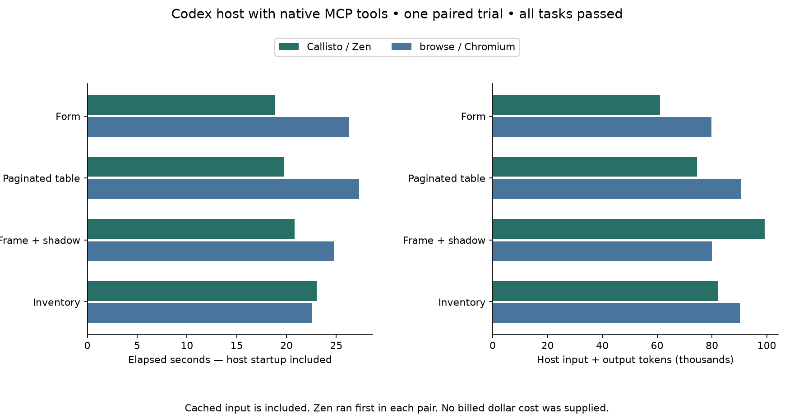

# Codex-host native MCP pilot — 15 November 2026

The signed-in Codex CLI supplied the model and conversation loop. It chose all
observations and browser actions through Callisto or browse MCP tools. This run
did not read `.env` or make direct model-provider API calls.

All eight tasks passed: four through Callisto/Zen and four through browse/Chromium.
Each task used a fresh Codex conversation with `gpt-6.1-sol`, high effort, the same
task policy and its disclosed native tool catalog. This is **one paired trial**
of four small local fixtures, with Zen first in each pair. It cannot establish
broad parity, statistical speedups, or a fraction-of-cost claim.

| Task | Runtime | Elapsed seconds | Input + output tokens | Cached input tokens | Browser calls | Outcome |
| --- | --- | ---: | ---: | ---: | ---: | --- |
| form | Callisto / Zen | 18.81 | 61,108 | 47,744 | 3 | Passed |
| form | browse / Chromium | 26.28 | 79,835 | 64,896 | 4 | Passed |
| grid | Callisto / Zen | 19.71 | 74,498 | 59,008 | 4 | Passed |
| grid | browse / Chromium | 27.30 | 90,604 | 76,032 | 5 | Passed |
| frame | Callisto / Zen | 20.80 | 99,179 | 82,944 | 6 | Passed |
| frame | browse / Chromium | 24.76 | 80,015 | 51,584 | 4 | Passed |
| search | Callisto / Zen | 23.02 | 82,078 | 60,032 | 4 | Passed |
| search | browse / Chromium | 22.57 | 90,158 | 68,608 | 4 | Passed |

Elapsed time includes Codex startup and MCP initialization. Browser setup,
initial navigation, explicit tab/native-input reacquisition and evaluator calls
are excluded. Input totals include cached input; cache effects and fixed engine
order limit latency and usage comparisons. Token counts come from the host’s
`turn.completed` events. **Per-run billed cost is unavailable (`null`)** under
this signed-in ChatGPT host; no API list price or subscription invoice is guessed.

The tools and underlying browsers differ. A private Unix-socket transport forwards
unchanged native catalogs/arguments/results through the owned fixture lease.
Callisto exposes eleven task tools; browse exposes its native `execute` tool.
The empty task workspace and disabled shell/web tools prevent fixture-answer
lookups through local files. No forbidden shell/web/file tool action occurred.

The initial run had a Callisto frame visibility refusal. It remains in the
[initial-run report](../host-agent-2026-11-15-initial/README.md). A regression
reproduced an active-tab refusal when another owned tab was active. The corrected
fixture explicitly reacquires its original tab and native input before each task;
the runtime’s visibility and sharing guards were not weakened. That setup
regression passes on both Zen and Firefox.

The source revision and scoped source-tree state are saved in `results.json`.
Provenance covers the runtime, Mini, scripts and agent-comparison sources; it
excludes report output, ordinary documentation edits and unrelated user settings.

- [Raw report and native catalogs](results.json)
- [Reproduction and host setup](../../../docs/host-agent-evaluation.md)
- Per-task JSON files contain visible Codex events, real usage and full native
  tool arguments/results. Private reasoning events were excluded.
- Regenerate the standalone figure with `plot.py` (matplotlib).
