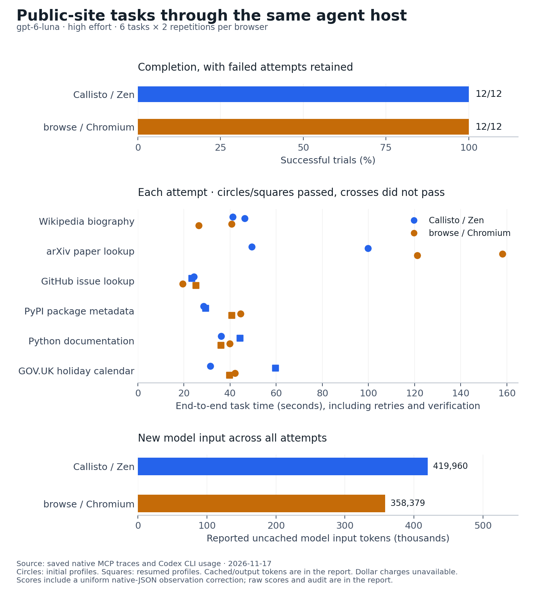

# GPT-6 Luna: compact Callisto / Zen and browse

Completed **24/24** planned trials. The full task set is complete.

Each task used a fresh signed-in Codex conversation configured with `gpt-6-luna` at `high` effort. The model chose its actions on 6 public, read-only goals, repeated 2 times per engine. Browser order alternated by task and repetition. Failed attempts are retained.

## All attempts

| Metric | Callisto / Zen | browse / Chromium |
| --- | ---: | ---: |
| Passed / attempted | 12/12 | 12/12 |
| Mean task time | 42.8 s | 52.8 s |
| Median task time | 38.6 s | 40.2 s |
| Total task time | 513.6 s | 633.2 s |
| Model input, including cache | 2,288,632 | 1,714,667 |
| Cached input | 1,868,672 | 1,356,288 |
| Uncached input | 419,960 | 358,379 |
| Model output, including reasoning | 14,920 | 13,971 |
| Reasoning output subset | 7,474 | 4,950 |
| Browser calls | 105 | 74 |
| Failed browser calls | 6 | 9 |
| Returned UTF-8 bytes | 350,364 | 233,694 |
| On-demand contract-help calls | 15 | 0 |

Token totals sum the supplied usage records: Callisto / Zen 12/12, browse / Chromium 12/12. Missing usage is not counted as zero cost. Reasoning is part of output and is not added twice. Cache-write input is retained separately in summary.json. Dollar charges are unavailable; bytes are not tokens or cost.

## Matched successful pairs

12 pairs passed on both engines; 12 used the same profile phase. 0 cross-phase pairs are excluded from matched latency. All attempts remain above.

| Metric | Callisto / Zen | browse / Chromium |
| --- | ---: | ---: |
| Mean task time | 42.8 s | 52.8 s |
| Median task time | 38.6 s | 40.2 s |
| Uncached input | 419,960 | 358,379 |

## Uniform scoring correction

Decode JSON values inside the native tab-header wrapper before exact-quote matching. The old reader could parse plain JSON but missed the same page text when browse prefixed it with a tab ID and page metadata. Apply the correction uniformly to every saved trial on both engines. Requested facts, source checks, no-direct-fetch checks, raw answers, timings, usage and traces are unchanged.

6 outcomes changed. Original passed counts were Callisto / Zen 12, browse / Chromium 6.
Raw results, answers, tool outputs, errors, timings and usage are unchanged. The scorer rechecks every saved trial on both engines; only decoded values actually present in native JSON observations are admitted. Offline re-scoring took 38.484656 ms outside original task timing. See [the correction audit](scoring-correction.json) and [reviewed results](results-reviewed.json).

These are descriptive timings, not a general speed guarantee or a billed-cost comparison.

## Every trial

| Task | Engine | Repeat | Outcome | Time | Calls | Errors |
| --- | --- | ---: | --- | ---: | ---: | ---: |
| wikipedia-biography | zen | 1 | passed | 41.1 s | 10 | 2 |
| wikipedia-biography | browse | 1 | passed | 40.6 s | 5 | 0 |
| arxiv-paper | browse | 1 | passed | 158.0 s | 13 | 2 |
| arxiv-paper | zen | 1 | passed | 49.5 s | 8 | 0 |
| github-issue | zen | 1 | passed | 24.3 s | 2 | 0 |
| github-issue | browse | 1 | passed | 19.4 s | 1 | 0 |
| pypi-metadata | browse | 1 | passed | 44.6 s | 5 | 1 |
| pypi-metadata | zen | 1 | passed | 28.6 s | 5 | 0 |
| python-json | zen | 1 | passed | 36.2 s | 10 | 1 |
| python-json | browse | 1 | passed | 39.8 s | 7 | 0 |
| govuk-calendar | browse | 1 | passed | 42.1 s | 5 | 1 |
| govuk-calendar | zen | 1 | passed | 31.4 s | 3 | 0 |
| wikipedia-biography | browse | 2 | passed | 26.3 s | 4 | 0 |
| wikipedia-biography | zen | 2 | passed | 46.3 s | 8 | 1 |
| arxiv-paper | zen | 2 | passed | 99.7 s | 29 | 2 |
| arxiv-paper | browse | 2 | passed | 121.1 s | 18 | 3 |
| github-issue | browse | 2 | passed | 25.1 s | 1 | 0 |
| github-issue | zen | 2 | passed | 23.4 s | 4 | 0 |
| pypi-metadata | zen | 2 | passed | 29.4 s | 5 | 0 |
| pypi-metadata | browse | 2 | passed | 40.6 s | 4 | 1 |
| python-json | browse | 2 | passed | 36.0 s | 6 | 0 |
| python-json | zen | 2 | passed | 44.2 s | 10 | 0 |
| govuk-calendar | zen | 2 | passed | 59.6 s | 11 | 0 |
| govuk-calendar | browse | 2 | passed | 39.6 s | 5 | 1 |

## Interpretation and next experiment

Callisto's mean time is 18.9% lower in this run, while its uncached input is 17.2% higher and total input including cache is 33.5% higher. This is not a billed-cost win.

The mean latency advantage is concentrated in arXiv. As a descriptive sensitivity check, excluding that task gives means of 36.4 s on Callisto and 35.4 s on browse. No rows are removed from the primary results.

Callisto used 105 calls, including 37 snapshots and 15 contract-help calls returning 17,227 bytes. browse used 74 calls. The largest Callisto input trial (arxiv-paper, repetition 2) alone used 29 calls, 762,669 input tokens including 685,312 cached, and 2 recovered argument/action errors. Callisto errors completed quickly, but the following model turns still consume context. browse failed calls consumed about 80.6 s in total.

The catalog is already small. The next controlled changes should reduce repeated observations and extra help/recovery turns: compose dependent actions with run, request one bounded observation at the end, and use typed extraction for requested facts. Test concise common-operation guidance and actionable validation messages against the observed errors. Then compare compact/full schemas on the same Luna runtime and tasks with cache usage recorded; this run alone cannot attribute a token effect to schema size.

| Goal | Callisto mean | browse mean |
| --- | ---: | ---: |
| Wikipedia biography | 43.7 s | 33.4 s |
| arXiv paper lookup | 74.6 s | 139.6 s |
| GitHub issue lookup | 23.9 s | 22.2 s |
| PyPI package metadata | 29.0 s | 42.6 s |
| Python documentation | 40.2 s | 37.9 s |
| GOV.UK holiday calendar | 45.5 s | 40.9 s |



## Failure and interface evidence

Failed tool calls, exact arguments, results and elapsed times are in summary.json and the per-trial traces. An error followed by task success is recovery, not evidence that the error was free. The operations/help counts above expose the cost of progressive contract discovery.

## Setup and measurement boundaries

- Host codex-cli 0.166.0; configured model `gpt-6-luna`, `high`. The CLI accepts that explicit model request and returns completed turns and usage. Its visible event stream does not independently echo an upstream served-model identifier.
- Zen 1.14.9b, runtime callisto-firefox-tab-mcp 0.3.1-alpha.1, extension source 0.3.1; Chromium 157.0.8103.38, browse 0.1.0, extension 0.0.16.
- The model saw one native compact Callisto tool (940 UTF-8 catalog bytes) or browse execute (4,113 bytes). Full catalogs and prompts are saved. This differs from the older Sol experiment and does not isolate the effect of compact schemas.
- browse 0.1.0 uses native tab-based execution. Its installed store package lacks a key for unpacked loading; the fixture copies it and adds browse's upstream public development key to its manifest. Code is unchanged. Source/loaded manifest hashes, API mode, source-file hashes and the public key source are saved. The current tab API has no legacy session origin allowlist; agents received a same-site policy and their traces were checked.
- Callisto uses synthetic DOM input; browse uses native Playwright input. Owned headful Xvfb profiles contain no personal logins or tabs. The Zen fixture pregrants optional permissions and pairs automatically; this is not an installation/onboarding test.
- Provisioning and neutral-tab reset are outside task time and recorded separately. Host startup, model work, navigation, waits, retries, shutdown and independent fact/evidence checks are inside task time. The model deadline is 180 seconds and the dispatch ceiling is 35 browser calls.
- The evaluator obtains official mutable facts separately and never supplies them to the model. Success requires the requested facts, an appropriate source URL and an exact supporting quotation found in browser observations. Direct API/file/network answers are prohibited by task policy and transcript checks.
- A separate paired Wikipedia preflight passed before this run. Its results and usage are not pooled into this comparison. It may have warmed provider-side prefix caches; full-run browser profiles were fresh. The first repetition is initially cold per site and the second is warm.
- The first coordinator used an invalid task ID and stopped before model access. A later setup-only attempt exposed the missing unpacked identity and changed browse API. Those attempts are retained separately and are not measured browser-task failures. No failed measured trial was silently repeated.
- Two repetitions over six informational tasks on one machine do not establish production reliability, authenticated-write coverage, general parity, or stable price/performance. Different interfaces, prompts, browser engines and cache behavior remain confounders.

## Artifacts

- [Raw results, catalogs, phases and answer oracles](results.json)
- [Derived summary and exact tool failures](summary.json)
- [Executed harness hashes](harness-sha256.json)
- [All artifact hashes](artifact-sha256.json)
- [Local validation: 20 checks passed](analysis/tests.log)
- [browse extension source hashes](browse-extension-sha256.json)
- Exact executed sources are under `harness/`; each trial JSON contains visible host events and native tool results. Private reasoning text is omitted.
- [Separate successful preflight](../luna-preflight-2026-11-17-run2/results.json)
- [Setup-only failure](../luna-preflight-2026-11-17/run-error.json)

## Reproduce

```sh
cargo build --locked --manifest-path packages/firefox-rs/Cargo.toml --bin callisto-firefox-tab-mcp
BENCH_HOST=codex BENCH_HOST_MODEL=gpt-6-luna BENCH_HOST_EFFORT=high \
BENCH_ZEN_TOOL_PROFILE=compact BENCH_REPETITIONS=2 BENCH_ENGINES=zen,browse \
BROWSE_EXTENSION_PATH=/absolute/path/to/browse-extension \
BENCH_OUTPUT_DIR=/tmp/new-luna-run \
xvfb-run -a node eval/agent-comparison/real-world-agent.mjs
python eval/reports/luna-real-world-2026-11-17/analysis/write-report.py /tmp/new-luna-run
```

Run the report script from its saved location, or copy it to the new output directory. Use `BENCH_TASKS=wikipedia-biography BENCH_REPETITIONS=1` and a separate output directory for the paired preflight. An existing signed-in Codex CLI and the documented browser dependencies are required.

## Continuation and cache reset

The session-boundary token guard stopped phase 0 after 16 trials. Only the 8 missing IDs resumed in fresh owned profiles in phase 1, with the same runtime, catalogs, model and effort. No measured trial was repeated or dropped. The guard was raised from 3 million to 5 million cumulative reported tokens for this one continuation.
Profile-phase trial counts: `{0: 16, 1: 8}`. All matched pairs use the same phase on both sides except the 0 explicitly excluded above. Browser caches reset between phases; the resumed second-repetition tasks therefore start cold in their new profiles.
The first guard error and original settings remain in `run-error-phase-0.json` and `results-before-phase-1.json`. The configured token guard is a session-boundary stop, not a strict per-request cap. Model input totals include cache hits.
