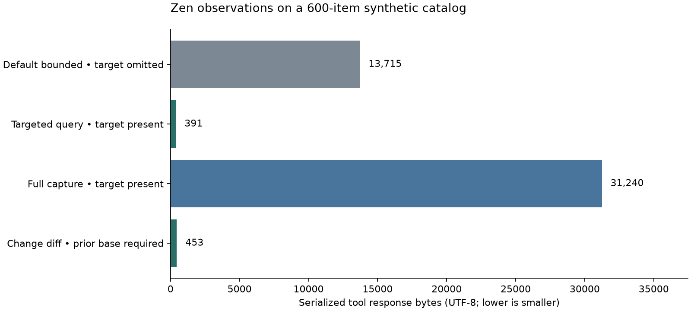

# Zen observation sizes — 15 November 2026

One owned, disposable Zen profile read a synthetic 600-item inventory. The
requested item was beyond the first bounded response. This is an observation
measurement, not an agent benchmark or a comparison with browse.

| Observation | Response bytes | Requested item present |
| --- | ---: | --- |
| Default bounded capture | 13,715 | No |
| Query for the known item name | 391 | Yes |
| Full capture after the change | 31,240 | Yes |
| Diff after one stock value changed | 453 | Yes |

The diff required a preceding full capture of 31,242 bytes. Its base cost cannot
be omitted when measuring a whole task. The query used the item name supplied
by the task; it does not show that an agent will always choose a useful query.
All sizes include serialized result metadata, rather than just visible text.

Runtime trace measurements matched all five snapshot calls. Actual model tokens,
model latency and billed cost were not measured. Shorter responses can omit
necessary information, as the default bounded capture demonstrates.

Reproduce with `node eval/agent-comparison/observation-efficiency.mjs` from a
checkout with the debug bridge built and Zen Flatpak/geckodriver/Xvfb installed.
Set `OBSERVATION_OUTPUT` to a fresh output directory before rerunning capture; artifact directories
are intentionally not overwritten. Regenerate the figure with `plot.py`.

- [Raw measurements](results.json)
- [Recorded action log](trace/actions.jsonl)
- [Capture manifest](trace/manifest.json)
