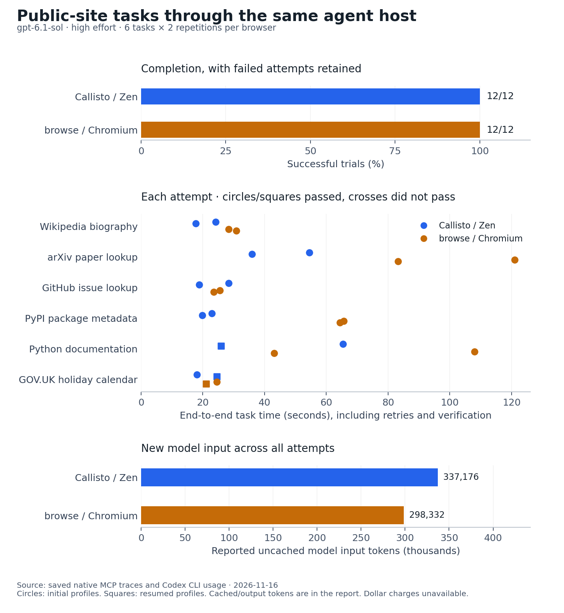

# Public-site agent comparison: Callisto / Zen and browse

Completed 24 of 24 planned runs. The task set is complete.

Both engines used fresh Codex conversations with gpt-6.1-sol, high effort. The six goals were public, read-only website tasks; selectors and action sequences were chosen by the model. Callisto used synthetic-dom input.

Scoring correction: Calendar answers can state the year once for both dates. Require the requested year in the answer and the correct two day/month values; do not require repeating the year after each date. This is applied uniformly to both engines and every saved trial. Requested facts, source URL, observed-quote and no-direct-fetch criteria are unchanged. Original answers, timings, usage, traces and raw results are preserved. Changed rows: 2. See scoring-correction.json and the unchanged initial scores in raw results/traces.

## Results including failed attempts

| Metric | Callisto / Zen | browse / Chromium |
| --- | ---: | ---: |
| Passed / attempted | 12/12 | 12/12 |
| Site-blocked trials | 0 | 0 |
| Infrastructure errors | 0 | 0 |
| Agent timeouts | 0 | 0 |
| Total task time | 356.5 s | 639.2 s |
| Median task time | 24.4 s | 37.0 s |
| Model input tokens (including cached) | 1,652,120 | 1,752,540 |
| Cached input tokens | 1,314,944 | 1,454,208 |
| Uncached input tokens | 337,176 | 298,332 |
| Model output tokens | 4,716 | 7,320 |
| Browser tool calls | 66 | 64 |
| Tool errors | 1 | 7 |
| Returned UTF-8 bytes | 385,314 | 221,999 |

Usage was supplied for 12/12 Zen trials and 12/12 browse trials. Billed dollar cost is unavailable; token counts are not converted into subscription charges.

## Matched successful trials

12 task/repetition pairs succeeded on both engines. 11 pairs used the same browser-profile phase on both sides and are included below. 1 cross-phase pair(s) are excluded from this matched latency comparison because a profile restart changed cache conditions. All attempts remain in the totals above.

| Metric | Callisto / Zen | browse / Chromium |
| --- | ---: | ---: |
| Mean end-to-end task time | 30.1 s | 54.2 s |
| Median end-to-end task time | 24.2 s | 30.8 s |
| Model input tokens | 1,528,415 | 1,627,025 |
| Uncached input tokens | 313,695 | 282,001 |
| Model output tokens | 4,284 | 6,497 |

## Each task and attempt

| Task | Engine | Repeat | Outcome | Task time | Browser calls |
| --- | --- | ---: | --- | ---: | ---: |
| wikipedia-biography | zen | 1 | passed | 24.2 s | 3 |
| wikipedia-biography | browse | 1 | passed | 28.3 s | 4 |
| arxiv-paper | browse | 1 | passed | 121.0 s | 11 |
| arxiv-paper | zen | 1 | passed | 54.6 s | 12 |
| github-issue | zen | 1 | passed | 28.4 s | 3 |
| github-issue | browse | 1 | passed | 25.5 s | 3 |
| pypi-metadata | browse | 1 | passed | 65.7 s | 5 |
| pypi-metadata | zen | 1 | passed | 22.9 s | 5 |
| python-json | zen | 1 | passed | 65.4 s | 7 |
| python-json | browse | 1 | passed | 108.0 s | 8 |
| govuk-calendar | browse | 1 | passed | 24.5 s | 3 |
| govuk-calendar | zen | 1 | passed | 18.1 s | 5 |
| wikipedia-biography | browse | 2 | passed | 30.8 s | 3 |
| wikipedia-biography | zen | 2 | passed | 17.7 s | 3 |
| arxiv-paper | zen | 2 | passed | 36.0 s | 10 |
| arxiv-paper | browse | 2 | passed | 83.2 s | 9 |
| github-issue | browse | 2 | passed | 23.6 s | 2 |
| github-issue | zen | 2 | passed | 18.9 s | 2 |
| pypi-metadata | zen | 2 | passed | 19.8 s | 5 |
| pypi-metadata | browse | 2 | passed | 64.4 s | 6 |
| python-json | browse | 2 | passed | 43.1 s | 7 |
| python-json | zen | 2 | passed | 25.9 s | 6 |
| govuk-calendar | zen | 2 | passed | 24.6 s | 5 |
| govuk-calendar | browse | 2 | passed | 21.1 s | 3 |

## Interpretation

For the 11 same-phase successful pairs, mean end-to-end time was 30.1 s on Callisto/Zen and 54.2 s on browse (1.80×). This is a descriptive result from this model and task set, not a general speed guarantee.

Across all attempts, uncached model input was 337,176 tokens for Callisto and 298,332 for browse. Model output was 4,716 versus 7,320 tokens. Cached-input differences and unavailable subscription charges prevent a billed-cost conclusion. Returned bytes are not substituted for model tokens.

Callisto recovered from 1 tool error(s), taking 8.1 s in those failed calls. browse recovered from 7 tool error(s), taking 180.5 s; 6 were 30-second locator timeouts. The speed difference therefore includes agent selector choices and error recovery, rather than measuring page-loading speed alone.



## Versions and measurement boundaries

- Zen 1.14.9b; Callisto runtime callisto-firefox-tab-mcp 0.3.1-alpha.1; extension source 0.3.1.
- Chromium 157.0.8103.38; browse CLI 0.0.16; extension 0.0.17.
- Host codex-cli 0.166.0; model gpt-6.1-sol, high effort.
- Runtime binary and extension source hashes, source revision, complete exposed tool catalogs and time-stamped answer oracles are in results.json. Exact phase-0 sources are saved under harness/ with harness-sha256.json; continuation sources are under harness-phase1/ with their own hashes. Scoring and report/plot sources are retained under analysis/.
- Owned anonymous profiles ran headfully on Xvfb. No personal tabs, accounts or saved logins were used. Initial provisioning and neutral-tab reset are outside task time and recorded separately. Subsequent site navigation, model turns, retries, waits, failures, host shutdown and answer/evidence checks are inside task time.
- The test extension pregrants optional permissions and pairs automatically in the owned profile; it has a fixture-only manifest version 0.2.1. This measures browsing, not store installation or user permission onboarding.
- The model receives native task tools: 14 Callisto tools or browse execute. The full exposed catalogs and backend-specific prompt text are retained. These differing interfaces and prompt/cache effects are part of this host-level comparison, not an isolated browser-engine test.
- Stable facts use fixed gold checks; mutable package, issue and calendar facts use official public API/JSON data captured before the trial. The model never sees the oracle data. Success requires requested facts, a correct source URL and an exact supporting quote found in browser output.
- Direct network/API/file access by the agent is prohibited. HTTP requests used by the evaluator are outside the agent and are not credited as browser actions.
- Two repetitions on one machine give a pilot comparison, not a stable production success rate or a general speed/cost claim. These are informational workflows; authenticated writes, downloads, popup/dialog handling and complex cross-origin applications are not covered.

## Artifacts

- [Raw results and task definitions](results.json)
- Profile restart: an internal reported-token guard stopped phase 0 after 21 trials. The remaining 3 trial IDs ran in new profiles. No trial was dropped or repeated. Runtime hashes and catalogs were checked for equality. 1 cross-phase pair(s) are excluded from matched latency; phase metadata and the original guard error are retained.
- [Reviewed scores](results-reviewed.json)
- [Scoring correction audit](scoring-correction.json)
- [Machine-readable summary](summary.json)
- Per-trial JSON traces contain exact prompts, visible host events, real reported usage and full tool arguments/results. Private reasoning events are omitted.
- The initial preflight URL-normalization failure is retained in ../real-world-2026-11-16/ and is not a measured agent trial.

## Reproduce

```sh
cargo build --locked --manifest-path packages/firefox-rs/Cargo.toml --bin callisto-firefox-tab-mcp
BROWSE_EXTENSION_PATH=/absolute/path/to/browse/extension \
BENCH_OUTPUT_DIR=/tmp/new-real-world-run \
xvfb-run -a node eval/agent-comparison/real-world-agent.mjs
node eval/agent-comparison/real-world-adjudicate.mjs /tmp/new-real-world-run
node eval/agent-comparison/real-world-report.mjs /tmp/new-real-world-run
uv run --with matplotlib==3.10.9 python eval/agent-comparison/real-world-plot.py /tmp/new-real-world-run
```

The runner needs an already signed-in Codex CLI, installed Zen Flatpak, geckodriver, Chromium, Xvfb, Python and browse. BENCH_TASKS restricts task IDs; BENCH_REPETITIONS supports 1–3. BENCH_INPUT_MODE=trusted-bidi is an explicitly different input configuration and should be reported separately.
