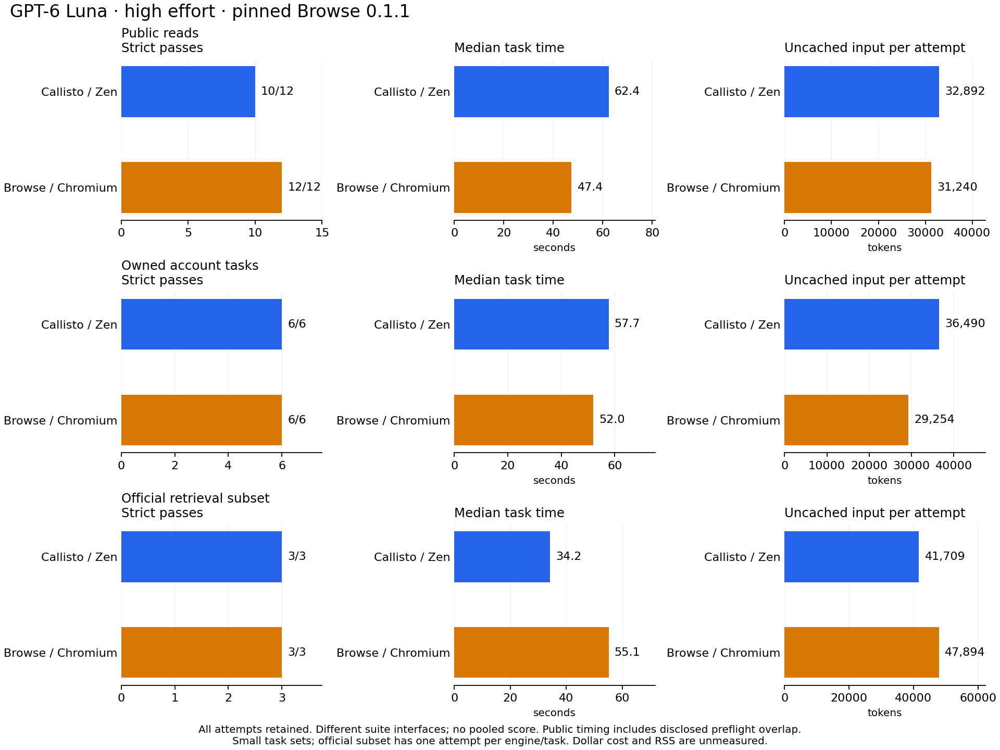

# Pinned Callisto / Browse screening — 17 November 2026

All **42 planned screening trials** completed through Codex requesting `gpt-6-luna`, high effort. Callisto does **not** beat Browse across these suites. It returned all public facts but failed two strict quote checks, tied on owned-account completion with more calls/input, and tied on official retrieval completion with lower observed time/input. The external subset has only three goals and one attempt per engine; it is not a full-suite or leaderboard result.

Browse CLI and extension are pinned to **0.1.1**. Callisto product source is frozen at `2138847`; its binary and extension hashes are retained in runtime-provenance.json. Harness-only revisions and exact executed source archives are separate. No store release or website performance claim was made.

## Results

Each cell lists **Callisto / Zen first, Browse / Chromium second**. All attempts, including failures, remain in these totals. The suites use different interface setups and are not pooled.

| Suite | Strict passes | Mean task seconds | Median seconds | Uncached input tokens | Host MCP calls |
| --- | ---: | ---: | ---: | ---: | ---: |
| Public reads | 10/12 · 12/12 | 66.4 · 53.5 | 62.4 · 47.4 | 394,702 · 374,883 | 115 · 67 |
| Owned account writes | 6/6 · 6/6 | 63.4 · 51.5 | 57.7 · 52.0 | 218,943 · 175,521 | 83 · 37 |
| Official retrieval subset | 3/3 · 3/3 | 40.0 · 49.3 | 34.2 · 55.1 | 125,127 · 143,681 | 18 · 26 |

[Interactive figure](comparison.html) · [machine-readable results](summary.json) · [measurement and deviations](methodology.md) · [reproduction guide](../../../docs/step5-evaluation.md)

Uncached input is a usage measure, not billed dollars. Cached input, output/reasoning and original returned UTF-8 bytes are retained separately. MCP calls include help and composition, so they do not equal model requests or underlying browser commands. Codex usage is real, but the CLI does not independently echo an upstream served-model identifier.

## What failed and what to improve

- **Public evidence:** all 12 Callisto fact checks passed. Two final answers concatenated snapshot fragments into purported exact quotes (Wikipedia biography and GitHub issue, repetition 2). The primary exact-quote rule remains unchanged: strict Callisto success is 10/12, Browse 12/12. Returned bytes were 427,242 versus 193,403; Callisto made 12 help calls.
- **Account efficiency:** both engines passed all six attempts, each with exactly one authenticated write. Receipt tasks also independently verified the new tab remained open. Callisto used 24 snapshots, 11 help calls, five status calls and four unnecessary pair calls. Its uncached input was 24.7% higher. Four Callisto tool errors and one Browse error remain counted.
- **Official retrieval:** both engines scored 1.0 on each of tasks 41, 94 and 208 using the official WebArena Verified 1.2.3 structural evaluator. Callisto had zero tool errors versus two for Browse. Callisto mean time was 40.0 seconds versus 49.3, and uncached input 125,127 versus 143,681. These are descriptive results on three tasks, with no broad superiority claim.

The next changes should remove unconditional pairing discovery, make argument-repair hints self-contained, provide bounded verbatim evidence, and reduce repeated snapshots after actions. [Evidence and acceptance checks](follow-ups.md) specify these separately from the frozen cohort. New tuning requires new held-out tasks.

## Scope and limits

The public suite uses a controlled task-tool facade. Account and official suites forward native initialization and expose default Codex-compatible catalogs. None measures OpenCode Code Mode model composition. OpenCode’s requested free DeepSeek model returned **HTTP 429 `provider.free-limit`** at availability preflight, so it has zero measured browser trials; no paid or alternate-model fallback ran.

An account preflight accidentally overlapped two public task/repetition pairs. Every primary row remains. A separate timing-only view excludes both engines for the affected pairs, retains eight strictly successful pairs, and still shows no Callisto timing advantage (mean 71.4 versus 56.3 seconds). Original inferred timestamps and the conservative window are preserved in the public overlap audit. Subsequent model runs were serial.

The earlier Luna pilot used Browse CLI 0.1.0 and extension 0.0.16. Different dependencies, site/model behavior and cache state prevent a causal before/after attribution. Multi-model comparisons, native/compact ablations, resource RSS, isolated cold starts, model-request counts, billed cost and full external suites remain unmeasured. Small task-cluster bootstrap intervals are retained, not interpreted as production reliability or stable tail latency.

## Evidence and validation

- [Public: 24 attempts, strict/facts-only scoring, overlap audit and exact harness](../luna-step5-public-2026-11-17/README.md).
- [Owned accounts: 12 attempts and independent write/tab checks](../luna-step5-account-2026-11-17/README.md).
- [Official retrieval: six attempts, official scores and exact harness](../luna-step5-webarena-2026-11-17/README.md).
- Four successful preflight model trials are separate and excluded from results. The first public preflight and two official full-suite setups failed before any model trial; their directories are retained. See methodology.md.
- [33 passing harness/scorer tests](artifacts/harness-tests.log) plus [one passing redaction regression test](artifacts/redaction-tests.log). The deterministic browser gate also passed all three account UI/state workflows before the full account cohort. Official fabricated-answer and unsupported-evaluator gates passed.
- [Pinned dependency build and extension file hashes](dependency-build.json), [runtime provenance](runtime-provenance.json), and [blocked OpenCode events](artifacts/opencode-provider-preflight.json).
- [Pairing-secret redaction audit](redaction-audit.json): expired owned-fixture codes were redacted, including duplicate host events. Original measurements are unchanged; exact private originals and hashes are retained. Published text length therefore differs from recorded byte counts for affected calls.
- `report-sha256.json` covers the published artifacts and exact executed harness archives. No personal browser profile, tabs, credentials or global CLI installation was changed.
