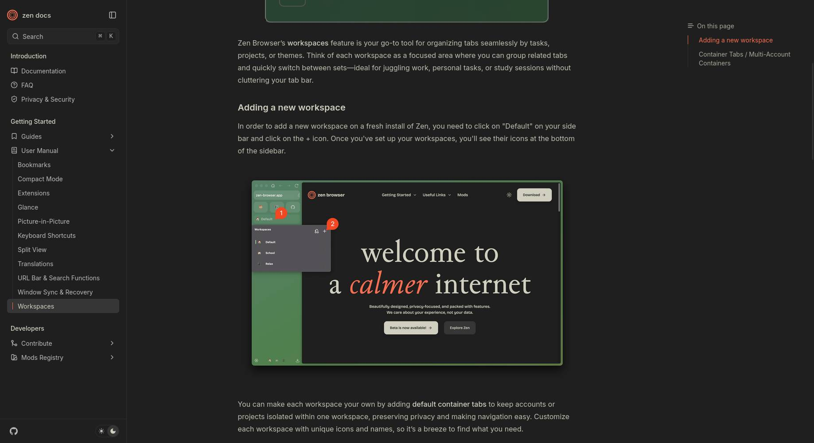

# Existing Zen browser: live research workflow — 12 November 2026

## Outcome

Completed a public-source research task through the Rust MCP extension relay in
the user's existing Zen window and existing profile. This was real browser work,
not an isolated fixture. The task required recovery and is **not** a clean
end-to-end pass. The original page was restored and verified at the end, then
`callisto_close` released control. Final status was `connected: true`,
`sharing: false`; browser-wide permission remained enabled.

The host in this chat called the real Rust stdio MCP executable through a local
client script. Each tool invocation started a fresh MCP client process, and all
reused the same persistent relay/browser pairing without another code. Tools
were not dynamically loaded as native tools into this already-running chat.

No new browser window, profile or browser tab was created for the task. The
existing tab was navigated temporarily. The task did not post comments, change
account settings, submit messages or mutate browser data. No private tab
inventory or authentication values are included in this report.

## Task and useful findings

Research Zen workspace extension support, follow original reports, and decide
whether Callisto should depend on workspace/container grouping.

Sources were read using Callisto's page text/snapshot tools in Zen:

- [Workspace API discussion #1215](https://github.com/zen-browser/desktop/discussions/1215)
  requests extension access to workspaces or documentation of an existing API.
  This is a feature request, not proof that no API can exist.
- [Issue #14108](https://github.com/zen-browser/desktop/issues/14108) reports
  missing/inaccessible tabs from inactive workspaces. It was **closed as a
  duplicate**, not established as fixed.
- Its canonical [issue #11210](https://github.com/zen-browser/desktop/issues/11210)
  was **open** when inspected, and linked a proposed fix.
- [Pull request #14828](https://github.com/zen-browser/desktop/pull/14828)
  addresses non-contiguous tab indices. It was **open**, with merge conflicts
  and changes requested, when inspected. Do not assume its fix has shipped or
  covers every workspace-query behavior.
- [Official workspace documentation](https://docs.zen-browser.app/user-manual/workspaces)
  distinguishes workspace organization from container cookie isolation. Its
  page says containers separate cookie sessions but not history/extensions.

Implementation implication: preserve each existing tab's cookie store. Grouping
must not silently reopen authenticated tabs in a new container. Treat
cross-workspace enumeration as a compatibility risk to test on specific Zen
versions; a closed duplicate issue is not evidence of a released fix.

## Observed workflow

1. Paired the current persistent relay once, then verified browser-wide access.
   No tab had been shared, so `callisto_snapshot` correctly refused access until
   an existing tab was explicitly selected through the authorized browser tool.
2. Selected the existing active regular webpage and navigated to DuckDuckGo.
3. Filled its homepage search combobox. A screenshot confirmed the entered
   query, but the snapshot did not expose a usable homepage submit control.
4. Recovered with a direct search URL and inspected actual search results.
5. Filled the results page's search combobox and clicked Search. The resulting
   URL/title and visible page text confirmed the query submitted. That narrow
   query returned no results; browser Back returned to the useful result list.
6. Clicked a result to open the original GitHub workspace API discussion in the
   same tab. The existing GitHub login was present; no new login was required.
7. Read issue #14108, clicked its canonical issue #11210, inspected the linked
   PR #14828, and cross-checked official documentation.
8. Scrolled the docs, searched visible text for a container-related term and
   captured a viewport screenshot.
9. Restored and verified the original page, released control, and checked that
   the persistent browser pairing remained connected.

## Failures and limitations exposed

- **Homepage search submission was incomplete.** Fill worked, but a visible
  search control was absent from the DOM snapshot. The current runtime has no
  Enter key tool. Direct navigation was a recovery, not a successful homepage
  form submission. This needs a snapshot/keyboard or explicit form-submit fix.
- **Successful navigation can be reported as an action error.** Clicking the
  results-page Search button submitted correctly, but the extension returned
  `Tab sharing changed during the action; inspect the page before retrying.`
  Page-load generation changes are currently conflated with user revocation.
  Inspecting the URL/page avoided an unsafe duplicate retry. A fix must
  distinguish navigation from actual sharing/ownership changes and preserve
  uncertain outcomes when the content message channel closes.
- **Foreground visibility matters.** One result click was refused because the
  shared document was not visible. Selecting/focusing the same tab and taking a
  fresh snapshot recovered. This prevents unnoticed background input but means
  the current interaction flow can compete with the user's foreground work.
- **Loading must be handled explicitly.** An immediate snapshot after browser
  Back returned a still-loading error. Status polling and recapture succeeded.
- **Snapshot perception remains incomplete.** The runtime used full visible
  body text to read substantive material and a screenshot when controls were
  missing from snapshots. Current combobox snapshots also did not expose the
  filled search value in the same way textbox snapshots do.

This is one manual, supervised task. It does not establish general site
compatibility, trusted input, unattended reliability, multi-agent isolation,
full workspace coverage or automatic reconnection after an actual Zen restart.

## Screenshot evidence

Captured with `callisto_browser` → `screenshot`, after scrolling the official
workspace documentation. It contains public webpage content only:

